  

<!-- Editing guide: docs/updating-profile.md. All project content is inside the marked blocks. -->

<!-- SELECTED:START. Each td is one card and each table is one row of two cards. A table with a single td makes a full-width card. -->
<table>
<tr>
<td width="50%" valign="top">

<h3><a href="https://github.com/sindredg/ai-security-platform">AI Security Platform</a></h3>

Self-hosted AI workers that investigate security findings and propose fixes. Isolated platform and target networks, no public addresses, and a single egress point. Actively building.

Azure, Terraform, K3s, self-hosted LLM  
</td>
<td width="50%" valign="top">

<h3><a href="https://github.com/sindredg/k8s-dr">Kubernetes Disaster Recovery</a></h3>

Recovering a stateful service after losing a region. Gitea and PostgreSQL run on a kubeadm cluster built on VMs, and a drill rebuilds it from code in a second region and restores an offsite backup. Actively building.

Google Cloud, Terraform, Ansible, Flux  
</td>
</tr>
</table>
<table>
<tr>
<td width="50%" valign="top">

<h3><a href="https://github.com/sindredg/k8-lab">Private GKE Cluster</a></h3>

A private GKE cluster that served public workloads, built with Terraform and deployed from GitHub Actions without a stored key. An AI agent triaged its security findings.

GKE, Terraform, GitHub Actions  
</td>
<td width="50%" valign="top">

<h3><a href="https://github.com/sindredg/cross-cloud-entra-aws">Entra ID to AWS</a></h3>

Workforce access to AWS managed from Entra ID: SAML sign-in, SCIM provisioning, access packages with approval and expiry, and joiner, mover, and leaver workflows.

Entra ID, AWS, Terraform  
</td>
</tr>
</table>
<table>
<tr>
<td width="50%" valign="top">

<h3><a href="https://github.com/sindredg/hybrid-network-az">Azure Hybrid Network</a></h3>

A hub-and-spoke network joined to an external network by an IPsec tunnel, with a hub firewall, private endpoints, and DNS that resolves in both directions.

Azure, VPN, Private Link  
</td>
<td width="50%" valign="top">

<h3><a href="https://github.com/sindredg/Access-Control-and-Identity-Governance">Access Governance</a></h3>

Conditional Access and risk-based policies, just-in-time administration with PIM, and recurring access reviews for a self-hosted Grafana.

Entra ID, Conditional Access, PIM  
</td>
</tr>
</table>
<!-- SELECTED:END -->

<!-- ARCHIVE:START. One Markdown bullet per project. Add, remove, or reorder freely. -->

<strong>Other projects</strong>

- **[Azure Container Apps](https://github.com/sindredg/container-app-in-azure)**: A public web tier and an internal API, built with Terraform. Images are pulled with a managed identity, so no registry password exists.
- **[AI Security Triage](https://github.com/sindredg/ai-k8s)**: The triage agent for the private GKE platform: rules first, then a model with scoped access, and an auditable ledger of verdicts.

<!-- ARCHIVE:END -->

 

---

Notes on building and testing cloud infrastructure.

